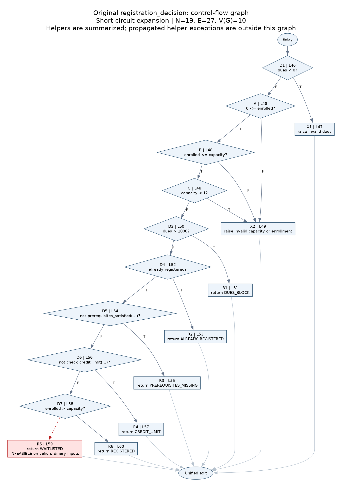

# Stage 4: white-box analysis of the original program

## Plain-language overview

Black-box testing asked what the program should do. White-box testing asks which decisions and routes inside it actually execute. We mapped the code, found untested routes, added five focused tests, and measured the same unmodified program again. We did not repair defects or replace the real decision function with a mock.

The suite now contains **78 tests: 48 passed and 30 failed**. Four new tests pass; WB-002 exposes the already reported dues bug at Rs. 1,000. There are still five distinct confirmed application defects, not 30 separate defects.

## Source, scope and assumptions

Source: `registration.py`, unchanged from starter commit `173a9692f61ce65f801e7799948bd52b9c1ae4b8`, SHA-256 `d6c35d6804dd3bcaed3cc164ab2f163ad8214792bdc410e258ec54cdd1099100`. Stage 4 branches from merged Stage 3 main `6b29e0cb8d89f4cc47b80c2b5f611d11db4534da`. Line references below refer to this original source.

The CFG is **intraprocedural** for `registration_decision`. It expands the short-circuit comparisons on line 48, includes the two explicit validation raises, and joins every explicit return/raise at a synthetic exit. Helper calls on lines 54 and 56 are summarized as normally returning predicates; their internal branches and propagated exceptions are not additional CFG edges. Basis-path fixtures use valid current/course credits. WB-004/005 separately exercise the helper-exception paths omitted by this convention. We do not claim a whole-program or all-exceptions complexity value.

Assume ordinary integer fields and sets/lists specified by the SRS, without concurrent mutations, custom comparison objects or monkeypatches. Structural inputs were chosen after inspecting source, but expected behavior remains based on the requirements. FR-02 defines the credit helper's errors; WB-004/005 check their propagation through its real caller, not a new global validation-priority requirement.

## B1: control-flow graph and complexity



Editable graph: `cfg.dot`; scalable version: `cfg.svg`; numbered node/edge/path inventory: `cfg_graph.json`.

Diamonds are decisions; boxes are return/raise operations; ovals are entry/exit. The function has no separate assignments to draw as processing nodes: its helper evaluations are included in D5/D6. D2 (line 48) is expanded into A, B and C below. T/F edge labels indicate the result of the specific displayed predicate. Red marks the syntactically present but infeasible waitlist route.

| Node | Original operation |
|---|---|
| E / Z | Entry / unified exit |
| D1 | L46: outstanding_dues < 0 |
| A | L48: 0 <= enrolled |
| B | L48: enrolled <= capacity, evaluated only if A is True |
| C | L48: capacity < 1, evaluated only if A and B are True |
| D3 | L50: outstanding_dues > 1000 |
| D4 | L52: course.code in registered_courses |
| D5 | L54: not prerequisites_satisfied(...) |
| D6 | L56: not check_credit_limit(...) |
| D7 | L58: enrolled > capacity |
| X1 / X2 | L47 / L49: raise dues / capacity-enrollment error |
| R1 / R2 / R3 | L51 / L53 / L55: return dues / duplicate / prerequisite status |
| R4 / R5 / R6 | L57 / L59 / L60: return credit-limit / waitlist / registered status |

Expanded convention:

- **N = 19 nodes**: entry + exit + 9 decision nodes + 8 return/raise nodes.
- **E = 27 edges**: 1 entry edge + 18 decision edges + 8 terminal-to-exit edges.
- **V(G) = E - N + 2 = 27 - 19 + 2 = 10** for one connected component.
- Cross-check: **9 binary decisions + 1 = 10**.

If the entire compound condition at line 48 is instead drawn as one decision, the same normal-return abstraction has N=17, E=23 and V=8 (7 source `if` statements + 1). Both conventions are explicit; **10 is the value used for this expanded graph**. Do not mix the coarse node count with the expanded decision count.

### Independent basis paths

Fixture baseline: student S001, completed {CS101, MATH101}, credits 12, dues 0, registered {CS100}; course CS201, hours 3, capacity 30, enrolled 29, prerequisites {CS101, MATH101}, waitlist [S999]. Changes below are relative to this baseline.

The common prefix to any node is `E → D1 → A → B → C → D3 → D4 → D5 → D6 → D7`, stopping at the named decision. Every path then follows its indicated terminal and Z. The first four paths use the shorter prefixes shown.

| Path | Node sequence / exit | Fixture change | Executable representative | Actual original result |
|---|---|---|---|---|
| P1 | E,D1,X1,Z | dues=-1 | BB-013 | Invalid dues |
| P2 | E,D1,A,X2,Z | enrolled=-1 | BB-020 | Invalid capacity or enrollment |
| P3 | E,D1,A,B,X2,Z | enrolled=31 | BB-019 | Invalid capacity or enrollment |
| P4 | E,D1,A,B,C,X2,Z | enrolled=0, capacity=0 | BB-018 | Invalid capacity or enrollment |
| P5 | Prefix through D3,R1,Z | dues=1001 | WB-001 | DUES_BLOCK |
| P6 | Prefix through D4,R2,Z | registered={CS100,CS201} | BB-015 | ALREADY_REGISTERED |
| P7 | Prefix through D5,R3,Z | completed={ENG101} | WB-003 | PREREQUISITES_MISSING |
| P8 | Prefix through D6,R4,Z | credits=16 | BB-017 | CREDIT_LIMIT |
| P9 | Prefix through D7,R5,Z | No feasible ordinary fixture | None: infeasible | WAITLISTED is never returned |
| P10 | Prefix through D7,R6,Z | Baseline unchanged | BB-011 | REGISTERED |

These ten formal path-edge vectors have rank 10 (checked from `cfg_graph.json`). Each validation path adds a different A/B/C failure edge; later paths add distinct return edges. Nine are feasible and represented by real test inputs. The tenth is a formal graph path only: **we cannot honestly supply ten executable independent paths for this faulty implementation**. We retain V=10 and document the infeasible path instead of inventing an execution.

### Why the waitlist path is infeasible

To get past line 48, `0 <= enrolled <= capacity` must be True and `capacity >= 1`. The function does not change enrollment/capacity between lines 48 and 58, and its helpers do not mutate the course. Therefore line 58's `enrolled > capacity` is False for every normally progressing input. Above-capacity inputs raise at line 49 instead. Full-course inputs (`enrolled == capacity`) incorrectly reach REGISTERED.

Consequently `register_course` also cannot receive WAITLISTED from the real decision function, so its waitlist append at line 71 is unreachable in normal execution. Both missing routes are consequences of existing Issue #6, not reasons to delete tests or exclude lines from coverage.

## B2/B4: structural additions and measured coverage

| Test ID | Input / expectation from requirements | Structural target | Local result |
|---|---|---|---|
| WB-001 | dues=1001 → DUES_BLOCK; no mutation | L50 True → previously uncovered L51; P5 | Pass |
| WB-002 | dues=1000 → DUES_BLOCK; no mutation | L50 False at the implementation's wrong threshold | **Fail**, returns REGISTERED; existing Issue #5 |
| WB-003 | completed={ENG101} → PREREQUISITES_MISSING; no mutation | L54 True → previously uncovered L55; P7 | Pass |
| WB-004 | current credits=-1, new=3 → Invalid current credits; no mutation | L56 calls helper → L30/L31 error propagation | Pass |
| WB-005 | current=12, new credits=0 → Invalid course credits; no mutation | L56 calls helper → L32/L33 error propagation | Pass |

WB-004/005 add caller-to-helper exception-path checks even though the helper's lines were already covered by direct black-box tests. Coverage growth is not the sole reason for a structural test. Existing black-box cases are reused as witnesses for the other basis paths and MC/DC rather than duplicated in the new suite.

| Metric, same original source | Black-box baseline | Black-box + white-box | Change |
|---|---:|---:|---:|
| Tests | 73 | 78 | +5 |
| Passed / failed | 44 / 29 | 48 / 30 | +4 / +1 |
| Module statements | 49/53 = 92.45% | 51/53 = 96.23% | +3.77 percentage points |
| Module branch outcomes | 22/26 = 84.62% | 24/26 = 92.31% | +7.69 percentage points |
| Combined coverage.py score | 71/79 = 89.87% | 75/79 = 94.94% | +5.06 percentage points |
| registration_decision statements | 12/15 = 80.00% | 14/15 = 93.33% | +13.33 percentage points |
| registration_decision branch outcomes | 11/14 = 78.57% | 13/14 = 92.86% | +14.29 percentage points |

Percentage-point changes are calculated before rounding. The terminal rounds the combined score to 90% then 95%; **that number is not the standalone statement or branch percentage**.

After additions, uncovered lines are **59 and 71**; missing branch arcs are **58→59 and 70→71**. Original gaps 50→51 and 54→55 are now covered. No exclusions, skips, xfails or mocks were used. The results are the final *pre-fix* Stage 4 measurement, not a final corrected-system result. Stage 5 will produce a separate corrected-source regression baseline.

Reproduce from the project root:

```bash
python -m pytest tests/ -v --tb=short --cov=registration --cov-branch --cov-report=term-missing
```

The separate analysis audit in `evidence/whitebox-analysis-check.json` confirms nine feasible representatives with actual source-line traces and checks all three MC/DC logical independence pairs. It is not an additional pytest suite or an instrumented condition-coverage tool.

Local evidence: `evidence/whitebox-original.txt`, `whitebox-original-junit.xml`, `whitebox-original-coverage.json`, `.xml`, and `whitebox-original-run.json`. Expected original-source exit code: **1**. The original black-box evidence remains intact. The HTML report is generated locally at `evidence/whitebox-original-html/index.html`; Actions also retains HTML as an artifact.

## B3: manual condition coverage

### Atomic conditions and scope

For the following manual metric, scope is **the nine predicates in registration_decision's expanded CFG**, with helper return predicates treated as single atoms. This is not a claim of condition coverage for all helper internals or the whole module. An atom counts as covered for a truth value only if it is actually evaluated with that value. NE means not evaluated because of an earlier return/raise or short-circuiting; NE is not False.

| Atom | True witness | False witness | Black-box truth values | After white-box |
|---|---|---|---|---|
| D1: dues < 0 | BB-013 | BB-011 | T,F | T,F |
| A: 0 <= enrolled | BB-032 | BB-020 | T,F | T,F |
| B: enrolled <= capacity | BB-032 | BB-019 | T,F | T,F |
| C: capacity < 1 | BB-018 | BB-032 | T,F | T,F |
| D3: dues > 1000 | WB-001 | BB-011 | F only | T,F |
| D4: already registered | BB-015 | BB-011 | T,F | T,F |
| D5: not prerequisites_satisfied | WB-003 | BB-011 | F only | T,F |
| D6: not check_credit_limit | BB-017 | BB-011 | T,F | T,F |
| D7: enrolled > capacity | Infeasible | BB-011 | F only | F only |

Initial manual condition coverage = **15/18 truth outcomes = 83.33%**. After additions = **17/18 = 94.44%**. The missing outcome is D7=True. Black-box BB-016 has missing prerequisites according to the SRS but the buggy helper returns True for partial overlap, making D5 False; expected business outcomes must not be mistaken for observed condition values.

### Evaluation truth table for representative paths

| Representative | D1 | A | B | C | D3 | D4 | D5 | D6 | D7 |
|---|---|---|---|---|---|---|---|---|---|
| BB-013 | T | NE | NE | NE | NE | NE | NE | NE | NE |
| BB-020 | F | F | NE | NE | NE | NE | NE | NE | NE |
| BB-019 | F | T | F | NE | NE | NE | NE | NE | NE |
| BB-018 | F | T | T | T | NE | NE | NE | NE | NE |
| WB-001 | F | T | T | F | T | NE | NE | NE | NE |
| BB-015 | F | T | T | F | F | T | NE | NE | NE |
| WB-003 | F | T | T | F | F | F | T | NE | NE |
| BB-017 | F | T | T | F | F | F | F | T | NE |
| BB-011 | F | T | T | F | F | F | F | F | F |

WB-004/005 reach the call in D6 but it raises; there is no Boolean D6 outcome in those cases. They do not add a truth value to the numerator.

### Other compound expressions (outside the metric above)

- L30: `not (0 <= current_credits <= 18)` has atoms `0 <= current_credits` and `current_credits <= 18`; the second is NE when the first is False. BB-003 (-1,1), BB-004 (19,1) and BB-021 (0,1) witness F/NE, T/F and T/T respectively.
- L32: `not (1 <= new_credits <= 4)` has atoms `1 <= new_credits` and `new_credits <= 4`; BB-005 (12,0), BB-006 (12,5) and BB-025 (12,1) witness F/NE, T/F and T/T after valid current-credit checks.
- L70: `decision == WAITLISTED and student_id not in waitlist` has atoms W and N. On original real executions that reach this elif, W is False and N is NE. W=True and N's independent effect cannot be demonstrated without changing/stubbing the preceding decision function. Neither is claimed covered here. BB-064/065 keep the required end-to-end expectations and fail earlier because the program registers a full course.

### MC/DC for line 48

Choose the compound invalid-capacity decision:

`D = not (A and B) or C`

A means `0 <= enrolled`, B means `enrolled <= capacity`, C means `capacity < 1`. Python's chained comparison evaluates B only when A is True; `or` evaluates C only when the left operand is False. These pure comparisons use unchanged integers.

| Row / existing test | enrolled, capacity | Logical A,B,C from inputs | Actually evaluated A,B,C | Decision D | Result |
|---|---|---|---|---|---|
| M0 / BB-032 | 0,30 | T,T,F | T,T,F | F | Continue validation/business decisions |
| M1 / BB-020 | -1,30 | F,T,F | F,NE,NE | T | Raise capacity/enrollment error |
| M2 / BB-019 | 31,30 | T,F,F | T,F,NE | T | Raise capacity/enrollment error |
| M3 / BB-018 | 0,0 | T,T,T | T,T,T | T | Raise capacity/enrollment error |

| Target condition | Pair | Independent effect |
|---|---|---|
| A | M0 versus M1 | B logically T and C logically F stay fixed; A changes T→F and D changes F→T. B/C are masked in M1. |
| B | M0 versus M2 | A=T and C logically F stay fixed; B changes T→F and D changes F→T. C is masked in M2. |
| C | M0 versus M3 | A=T and B=T stay fixed; C changes F→T and D changes F→T. All atoms execute. |

**Short-circuit-aware masking MC/DC: 3/3 conditions demonstrated = 100% for this selected decision.** At the pure logical valuation level these also hold non-target values fixed, but we do not pretend skipped comparisons executed. If an assessor uses a strict convention requiring every non-target condition to be evaluated in both rows, A/B cannot meet that convention with this short-circuit expression; the masking convention here is explicit.

All four witnesses already existed in the black-box suite. Therefore MC/DC for this chosen decision is **100% before and after additions**; Stage 4 adds the analysis and independent-effect argument, not a fabricated improvement. Six of six evaluated atomic truth outcomes are covered within this compound decision. This does not imply 100% condition coverage for the whole function or program.

These are manually derived tables from source semantics and executed case inputs. pytest-cov does not calculate these MC/DC or condition percentages. Its branch measurement follows source-line transitions, so its branch denominator differs from this expanded graph. References: [coverage.py measurement](https://coverage.readthedocs.io/en/7.16.2/howitworks.html) and [NASA MC/DC tutorial](https://ntrs.nasa.gov/api/citations/20010057789/downloads/20010057789.pdf).

## Review and next stage

PR #2 and PR #7 were merged during Stage 3 after the recorded assisted approvals. This Stage 4 work is a separate whitebox-testing contribution. All AI assistance must remain disclosed; the review history must not be described as independent human execution. Stage 5 will fix defects on a separate branch after this original-source evidence is preserved. Stage 6 will assemble the final PDF report. Do not mark the full assignment complete at this checkpoint.
